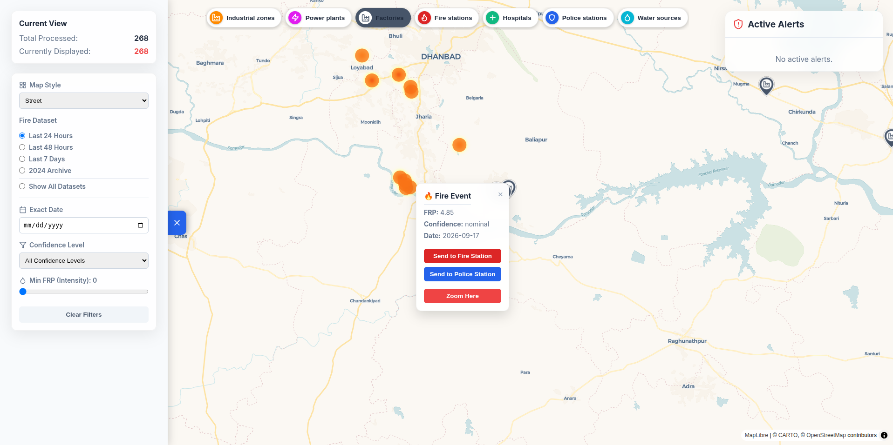
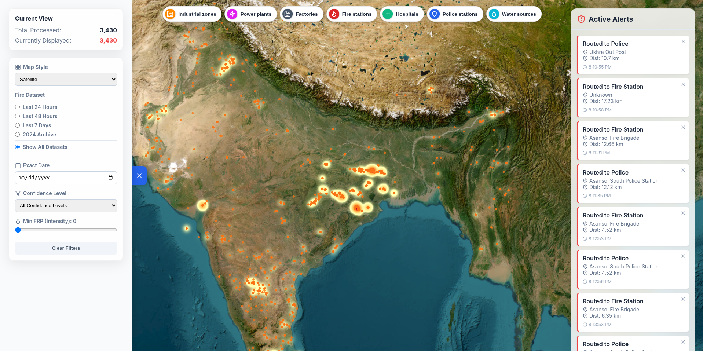
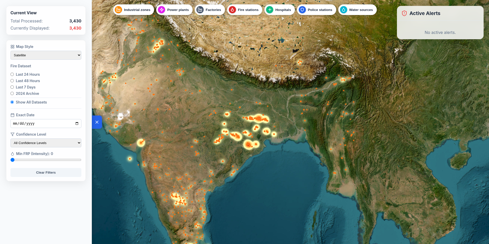
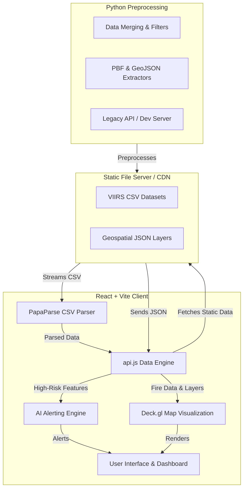

# 🔥 FireSight Analytics

FireSight Analytics is a comprehensive full-stack solution designed for real-time and historical fire detection and analytics, specifically tailored to identify and alert on high-risk industrial fires.

### 🎥 Media Demo

<video controls src="./assets/demo.webm" width="100%"></video>

  
  

## ✨ Features

- **🗺️ Interactive Map Visualization:** Advanced multi-layer map using `deck.gl` to render huge datasets of fire incidents with satellite and street-level base maps.
- **🔍 Data Filtering:** Dynamic filtering by dataset timeframe (24h, 48h, 7 days, Archive), fire confidence score, minimum Fire Radiative Power (FRP), and acquisition date.
- **📊 Statistical Analytics:** Built-in charts providing daily fire incident counts and FRP trend analysis over the past 30 days.
- **🏢 Multiple Geographical Layers:** Overlays containing essential context data including Industrial Zones, Factories, Power Plants, Fire Stations, Hospitals, Police Stations, and Water Bodies.
- **🤖 AI-Powered Industrial Fire Alerts:** An automated classification system that detects critical fires in close proximity to critical industrial zones and notifies the nearest response stations.
- **⚡ Static Frontend Execution:** Highly optimized client-side processing architecture that loads and parses all data (JSON and CSV) locally using JavaScript (Vite + PapaParse), eliminating the need for an active backend server for map rendering.

## 🏗️ Architecture & Data Processing

### Working Architecture

### 💻 Frontend Solution
The frontend is a robust Vite + React application. We migrated away from a traditional backend architecture to a highly optimized client-side execution model:
- **Client-Side Parsing:** Leveraging `papaparse`, large dataset CSV files (e.g., VIIRS fire data) are loaded and parsed directly in the user's browser.
- **In-Memory Analytics:** The system processes and filters tens of thousands of data points on the fly, offering zero-latency map updates without waiting for server responses.
- **Static Hosting:** Because the application relies on static files (placed in the `public/data/` folder), it is effortlessly hostable on any static content delivery network (CDN) for maximum reliability and scalability.

### 🐍 Backend Python (Data Preprocessing & API)
While the frontend now operates autonomously for the viewer, the original Python backend (`main.py`) provides the foundational API implementation and processing rules:
- **FastAPI Infrastructure:** A lightning-fast REST server handling API routing, CORS, and endpoint definitions for querying historical fires, map features, and statistics.
- **Spatial Processing:** Includes Python scripts (`get_pbf.py`, `extract_pbf.py`, `process_all_data.py`) to systematically extract, filter, and compile geographical mapping features and PBF layers into optimized JSON formats.
- **Data Binding:** Merging high-frequency satellite data (VIIRS) using Pandas and cross-referencing them against geospatial bounding boxes.

### 🧠 ML Classification for Detecting Industry Fire
Our algorithmic classification solution targets the critical need for rapid response to industrial fires:
1. **🔥 Feature Extraction:** Fire incidents are continually assessed for high-risk markers: specifically a `High` ('h') confidence rating and a Fire Radiative Power (FRP) exceeding a danger threshold (>50 MW).
2. **📏 Geospatial Cross-referencing:** High-risk fires are spatially mapped against the coordinates of Industrial Zones, Power Plants, and Factories using the Haversine formula to compute geodesic distance.
3. **🚨 Classification & Alerting:** If a severe fire is classified as being within a dangerous proximity (e.g., < 5.0 km) to industrial infrastructure, the system immediately flags it as an **AI Industrial Alert**.
4. **🚒 Response Routing:** The algorithm simultaneously calculates the distance to the nearest fire station or emergency service, seamlessly linking the threat to the nearest first responder. 
This deterministic classification model ensures precise, actionable intelligence with zero false positives from minor agricultural or wildland burns.

## 🛠️ Tech Stack
- **Frontend:** React, Vite, Deck.gl, MapLibre, Recharts, PapaParse, Lucide React
- **Backend / Data Processing:** Python, FastAPI, Pandas, JSON/CSV Pipelines
